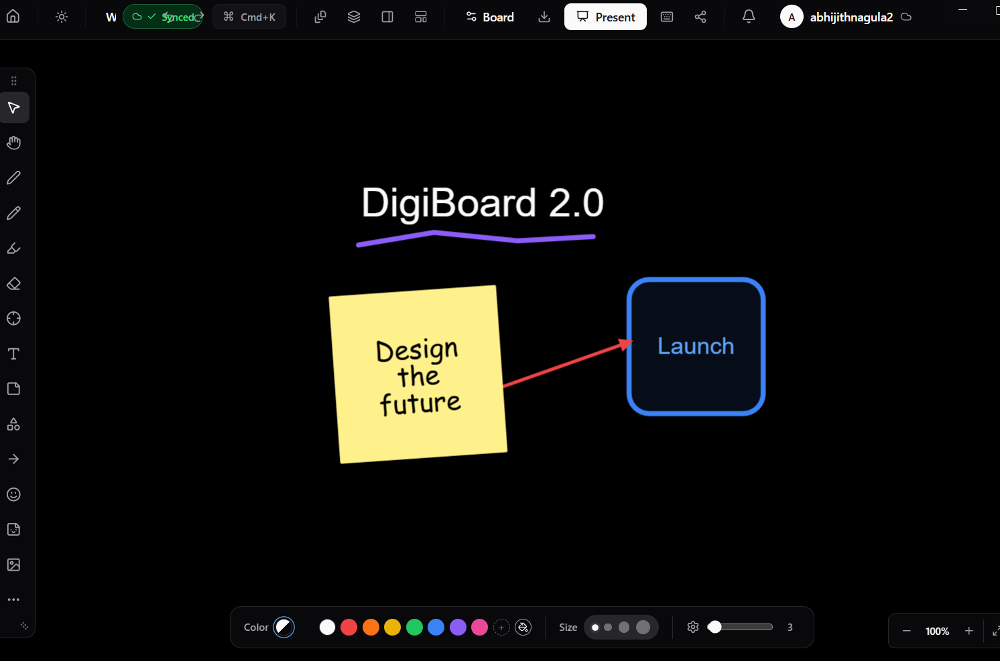
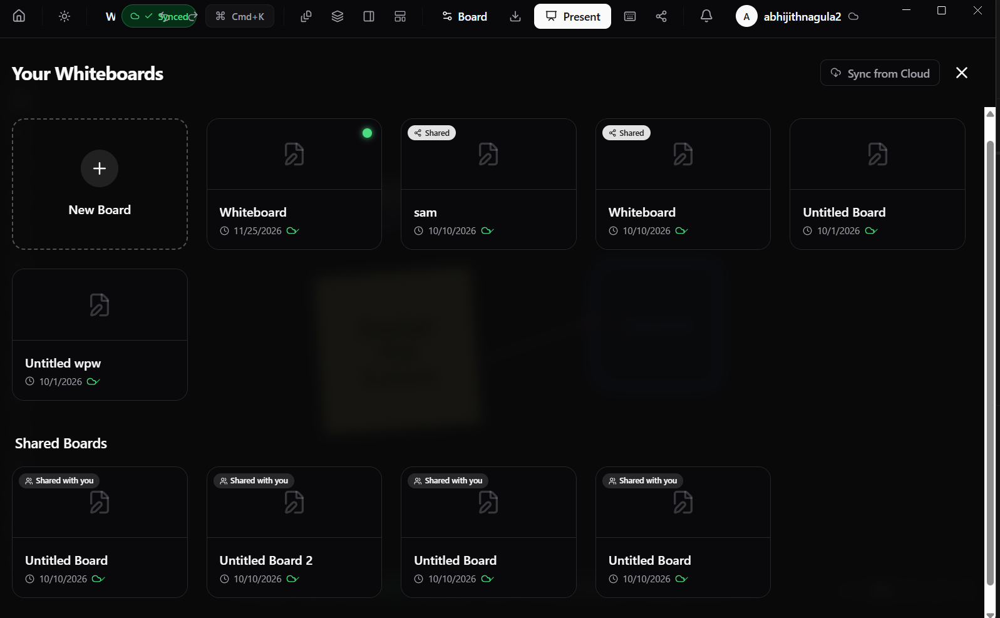
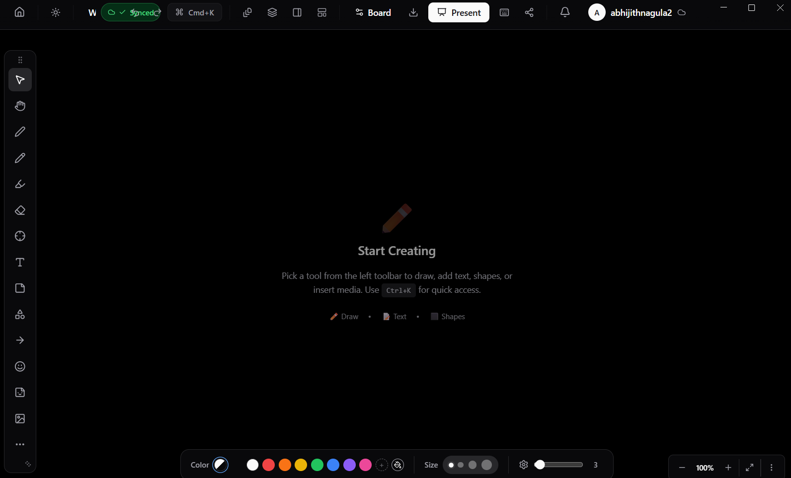

# Digiboard

A desktop whiteboard app for Windows with an infinite canvas for drawing, diagramming, and brainstorming. It works offline, and you can sign in to sync boards across devices and share them with others. Digiboard is available on the Microsoft Store.

Built with Electron, React, TypeScript, Konva, Vite, Tailwind CSS, and Supabase.

## Screenshots







## Features

- Infinite canvas with panning and zooming
- Offline-first auto-save using IndexedDB
- Multiple board management
- Customizable board themes (dots, grid, ruled, solid colors)
- Drawing tools: Pen and Eraser with customizable thickness and colors
- Shape tools: Rectangle, Circle, Triangle, Line, and Arrow
- Text fields and Sticky notes
- Image import support
- Export to PNG or JSON
- Import from JSON
- Layers panel, templates, and an asset library
- Presentation mode and a command palette
- Optional sign-in with cloud sync across devices (Supabase)
- Share boards with other people by link

## Installation

Install Digiboard from the Microsoft Store, or download the compiled Windows executable from the Releases page.

1. Go to the [Releases](../../releases) tab on GitHub.
2. Download `Whiteboard Setup X.X.X.exe` for the installer or `Whiteboard X.X.X.exe` for the portable version.
3. Run the downloaded file.

## Keyboard Shortcuts

| Shortcut | Action |
| --- | --- |
| `Space + Drag` | Pan canvas |
| `Ctrl + Scroll` | Zoom in/out |
| `V` | Select |
| `H` | Pan |
| `P` | Pen |
| `E` | Eraser |
| `T` | Text |
| `N` | Sticky Note |
| `R` | Rectangle |
| `Ctrl + Z` | Undo |
| `Ctrl + Shift + Z` | Redo |
| `Ctrl + C` | Copy |
| `Ctrl + V` | Paste |
| `Ctrl + D` | Duplicate |
| `Ctrl + G` | Group |
| `Ctrl + Shift + G` | Ungroup |
| `Delete` / `Backspace` | Delete selected |
| `Esc` | Cancel action |

## Development

Requirements: Node.js (v18+)

### Setup

1. Clone the repository
2. Install dependencies:
```bash
npm install
```

3. Set up environment variables:
```bash
# Copy the example files
copy .env.example .env
copy supabase\config.toml.example supabase\config.toml

# Edit .env and add your Supabase credentials:
# - VITE_SUPABASE_URL (your Supabase project URL)
# - VITE_SUPABASE_ANON_KEY (your Supabase anon/public key)

# Edit supabase/config.toml and add your project_id
```

4. Start development:
```bash
# Start development server
npm run dev

# Build the executable
npm run build
npm run pack
```

### Getting Supabase Credentials

1. Create a free account at [Supabase](https://supabase.com)
2. Create a new project
3. Go to Project Settings → API
4. Copy your project URL and anon/public key
5. Add them to your `.env` file

### Database Setup

Cloud sync and sharing need these tables and policies in your Supabase project. In the Supabase SQL Editor, run these files in order:

1. `supabase/sql/01-schema.sql`: tables, triggers, and base policies
2. `supabase/sql/02-sharing.sql`: board sharing
3. `supabase/sql/03-rls.sql`: final row-level security policies

The app works without Supabase. Boards are then saved only on the device.

## License

This project is licensed under the [MIT License](LICENSE).
